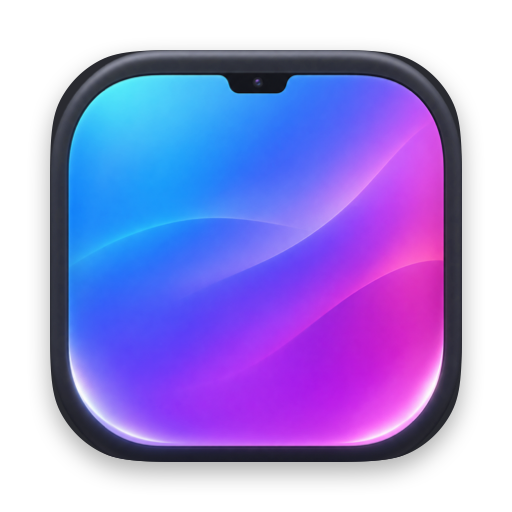
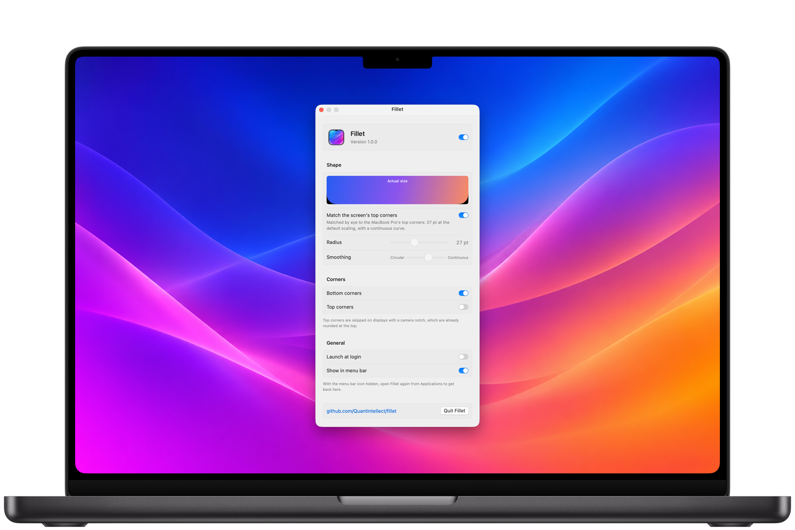
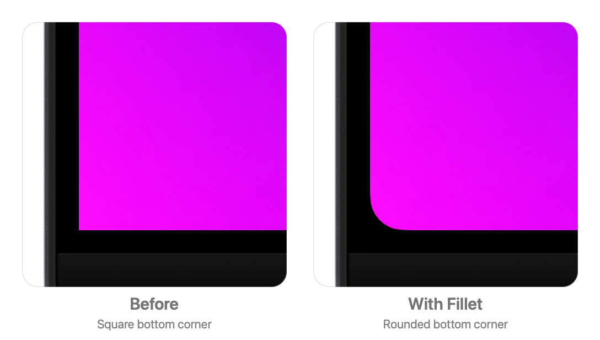
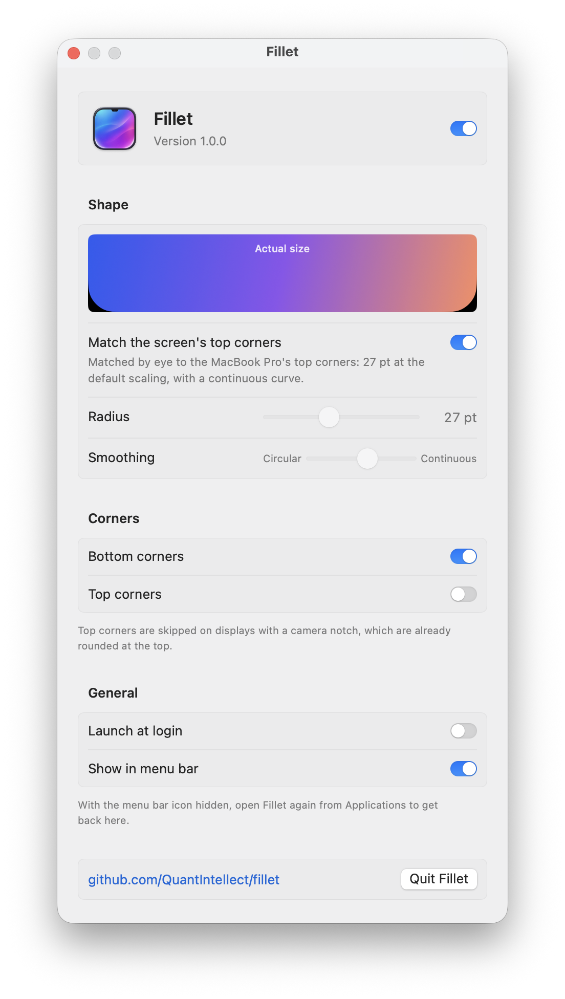

<p align="center">
  
</p>

<h1 align="center">Fillet</h1>

<p align="center">
  <b>Rounded bottom corners for your MacBook's screen, matched to its rounded top corners.</b><br>
  Steady through Space switches and full-screen apps.
</p>

<p align="center">
  <a href="https://github.com/QuantIntellect/fillet/releases/latest"></a>
  
  
  <a href="LICENSE"></a>
</p>

<p align="center">
  
</p>

A MacBook Pro screen is rounded at the top and square at the bottom. Fillet rounds the bottom two corners to
match the top ones, so the whole screen reads as one shape, much like the new MacBook Pro with the PROLED XDR
display.

<p align="center">
  
</p>

## Features

- **Matches your screen.** By default the bottom corners copy the MacBook Pro's top corners: 27 pt at the
  default scaling with a continuous ("squircle") curve, matched by eye on a 16-inch MacBook Pro. On the
  built-in display the curve keeps its physical size if you change the scaling; other displays get 27 pt.
- **No blinking.** The corners live in their own layer above every Space, so they stay put while you swipe
  between desktops and while apps enter or leave full screen.
- **Works in full screen**, for videos, presentations and anything else in a full-screen app.
- **Your own shape if you prefer.** Turn off matching to pick any radius from 4 to 60 pt and anything from a
  circular arc to a fully continuous curve, with a live preview at actual size.
- **Top corners too**, for external displays that are square at the top. Displays with a camera notch are
  skipped, since they're rounded at the top already.
- **Out of the way.** The corners never catch a click. Menu bar icon (which you can hide), launch at login,
  and no Dock icon.

<p align="center">
  
</p>

## Install

1. Download `Fillet-1.0.0.zip` from the [latest release](https://github.com/QuantIntellect/fillet/releases/latest),
   unzip it, and move **Fillet** to your Applications folder.
2. Open it. Fillet isn't notarized by Apple, so the first launch is blocked: open
   **System Settings › Privacy & Security**, scroll down and click **Open Anyway**. Or run
   `xattr -dr com.apple.quarantine /Applications/Fillet.app` in Terminal.
3. Settings opens the first time. Turn on **Launch at login** to keep it running.

Opening Fillet again, from Applications or Spotlight, brings Settings back. That's handy if you've hidden the
menu bar icon.

## Build from source

You need Xcode or the Command Line Tools (Swift 5.9 or later).

```sh
git clone https://github.com/QuantIntellect/fillet.git
cd fillet
scripts/build.sh --install   # builds build/Fillet.app, copies it to /Applications and opens it
```

`scripts/build.sh --zip` makes the release archive. `scripts/make-icon.swift` fits the artwork in
`design/icon` to the macOS icon shape and writes `Resources/AppIcon.icns`. The README images come from
`scripts/stage-backdrop.swift` (covers the screen with the wallpaper in `design/wallpaper`),
`scripts/check-capture.swift` (rejects any screenshot that shows anything else) and `scripts/make-images.swift`.

## Settings from Terminal

Every setting applies immediately:

```sh
defaults write com.quantintellect.fillet matchTopCorners -bool false
defaults write com.quantintellect.fillet radius -float 24       # points, 4 to 60
defaults write com.quantintellect.fillet smoothing -float 0.6   # 0 = circular arc, 1 = most continuous
defaults write com.quantintellect.fillet topCorners -bool true
defaults write com.quantintellect.fillet showMenuBarIcon -bool false
```

## How it works

- **The corners** are small, black, click-through windows in the bottom corners of each display.
- **Why they don't blink.** Ordinary windows, even ones set to appear on every Space, are carried along with
  Space and full-screen animations and vanish for a moment. Fillet makes its own WindowServer space, pins it
  above everything with an absolute level, and puts its windows there, so those animations happen underneath.
  This uses private calls (`CGSSpaceCreate`, `CGSSpaceSetAbsoluteLevel`).
- **The curve** follows Figma's corner-smoothing construction: a Bézier curve into a circular arc and out
  again.
- **The default shape** was matched by eye against the real top corners of a 16-inch MacBook Pro: 54 native
  pixels (27 pt at the default scaling) with smoothing 0.57. Apple's MacBook Pro product bezel artwork
  (Apple Design Resources) draws the corners a little smaller. Its screen cut-outs measure:

  | Bezel artwork | Radius | Smoothing |
  | --- | --- | --- |
  | MacBook Pro 16-inch, top corners | 39 px | 0.9 |
  | MacBook Pro 14-inch, top corners | 38.5 px | 0.8 |
  | MacBook Pro with PROLED XDR display, all four corners | about 61.5 px | about 0.65 |

  If your eyes disagree, turn off matching and set your own radius and smoothing.

## Good to know

- **Screenshots.** The corners are drawn on screen like any window, so they show up in screenshots and screen
  recordings.
- **Private API.** The no-blink trick relies on undocumented macOS calls that a future update could change.
  If they ever fail, Fillet falls back to ordinary windows: the corners still work but blink during
  transitions.
- **What's been tested.** A 16-inch MacBook Pro on macOS 27 (Apple silicon), including full-screen apps and
  Space switches. Not yet tested: external displays and the Top corners option, MacBook Air, Intel Macs (the
  download is universal), macOS 13 to 26, changing display scaling, sleep and wake, and the lock screen.
- **Black pixels** on a mini-LED display aren't strictly off, but with local dimming they're as dark as the
  panel gets.

## Credits

- Corner smoothing: Figma's [Desperately seeking squircles](https://www.figma.com/blog/desperately-seeking-squircles/)
  and [figma-squircle](https://github.com/phamfoo/figma-squircle) by Tien Pham (MIT).
- The floating-space technique, as used in [boring.notch](https://github.com/TheBoredTeam/boring.notch)
  (originally from [Parrot](https://github.com/avaidyam/Parrot)).
- The app icon and the wallpaper in the screenshots were made with image generation in OpenAI Codex.
- The screenshots are staged: Fillet running on a 16-inch MacBook Pro over a full-screen wallpaper, with the
  Settings window added to the hero image, framed with Apple's MacBook Pro product bezel from
  [Apple Design Resources](https://developer.apple.com/design/resources/). The bezel file itself isn't in this
  repository.

MacBook Pro is a trademark of Apple Inc. Fillet is an independent project and isn't affiliated with or endorsed
by Apple.

## License

MIT © 2026 QuantIntellect. See [LICENSE](LICENSE), which also carries the figma-squircle notice.
The MIT license doesn't cover `docs/images/hero.png` and `docs/images/corners.png`, which include Apple's
product bezel artwork, used under Apple's Design Resources license.
